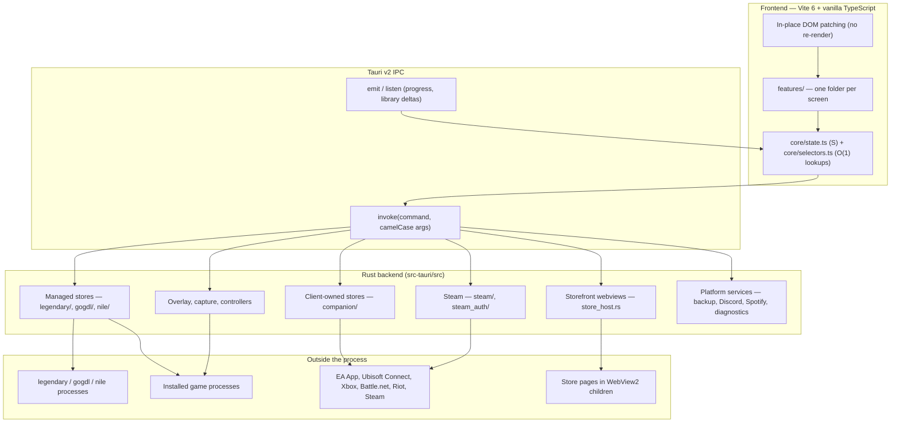
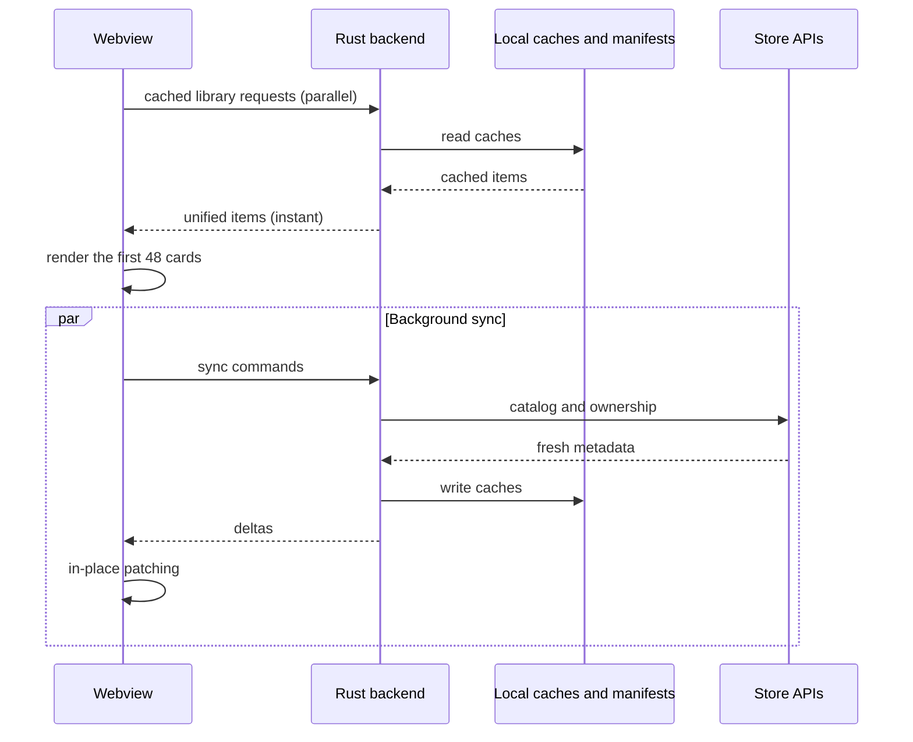

# Architecture & Technical Design — Efxlve Launcher

Efxlve Launcher is a Tauri v2 desktop application: a Rust backend that owns every
file, process and network call, and a frameworkless Vanilla TypeScript (Vite 6)
frontend that owns only the DOM and the view state.

The frontend never talks to a store directly. It calls a Tauri command, the Rust
side does the work, and the answer comes back either as a command result or as an
event. This document describes those boundaries. Feature-level rules live in
[AGENTS.md](./AGENTS.md) and [CONTRIBUTING.md](./CONTRIBUTING.md); tokens and
layout contracts live in [docs/DESIGN_SYSTEM.md](./docs/DESIGN_SYSTEM.md).

---

## 1. Layers

---

## 2. Frontend

| Path | Job |
|---|---|
| `src/main.ts` | Entry point. Imports the stylesheet, wires the render orchestrator and the "close every modal" helper. |
| `src/core/` | Shared state (`state.ts`), lookups (`selectors.ts`), navigation, render helpers, i18n, DOM helpers. Must not import `src/features/`. |
| `src/features/<name>/` | One screen or feature. Features import `core/` and assign to the `S` binding; they never reassign it. |
| `src/features/events/` | Bootstrap and IPC wiring (`ipc-listeners.ts`), the single document click listener (`click-router.ts`, `data-act`), input listeners. |
| `src/styles/` | Design tokens, components and per-surface CSS. |
| `src/locales/` | 16 locale JSON files with identical key sets. |
| `src/*.ts` (root) | Store barrels and IPC wrappers (`epic.ts`, `epic-commands.ts`, `gog.ts`, `nile.ts`, `steam.ts`, `companion.ts`, `compat.ts`, `custom-games.ts`). |

**Rendering.** The library is not re-rendered as a whole. The first viewport draws
48 cards, an `IntersectionObserver` sentinel appends 36-card chunks, and every
later change — download progress, playtime, achievements — patches the existing
card through `patchLibraryCardDom`, `data-dlbtn` or `data-dlbar`. The chunk sizes
live in `src/core/constants.ts`. A render path never performs a linear `.find()`
across the library; `summaryOf` and `rawOf` are hash lookups.

**Clicks.** One document-level listener reads `data-act` and dispatches to a
handler. Clicks bubble; handlers do not call `stopPropagation()`.

---

## 3. Backend map

### 3.1 Managed stores

These own the whole lifecycle — install, update, uninstall, launch — by driving
an external CLI and parsing its output.

| Module | Job | Start at |
|---|---|---|
| `legendary/` | Epic Games through the Legendary CLI. `commands/` is the IPC surface (one file per job), `transfers/` is the download queue, pause/resume, launch and uninstall path. | `legendary/commands/mod.rs`, `legendary/transfers/mod.rs` |
| `gogdl/` | GOG.COM through gogdl plus the Galaxy REST APIs: accounts, catalog, installs, updates, playtime, presence. | `gogdl/mod.rs` |
| `nile/` | Amazon Games through the Nile CLI: accounts, auth, library, transfers. | `nile/mod.rs` |
| `comet/` | GOG Galaxy Communication Service replacement, so GOG games unlock achievements with Galaxy closed. | `comet/mod.rs` |

Legendary progress is printed on stderr and its JSON on stdout; `transfers/parse.rs`
owns that split.

### 3.2 Client-owned stores

The game stays inside the vendor's client; the launcher reads a local catalog and
hands launch back to that client.

| Module | Job |
|---|---|
| `companion/` | EA App, Ubisoft Connect, Xbox, Battle.net and Riot: account link and sign-in (`*_login.rs`, `*_vault.rs`), catalog scan (`scan.rs`), covers, and launch hand-off. |
| `launchers.rs` | Detects which store clients are installed and where, for Settings → Launchers. |
| `egl_removal.rs` | Removes the Epic Games Launcher without taking the game folders with it. |
| `epic_shim.rs` | `EpicGamesLauncher.exe` stand-in for Rockstar's Epic launch relay. |
| `eos.rs` | Detects and reinstalls the Epic Online Services redistributable. |

### 3.3 Steam

Steam is read, never replaced. Actions go back through `steam://` or the client's
own registry flags.

| Module | Job |
|---|---|
| `steam/` | VDF parsing, library folders and manifests, store catalog and DLC, achievements, playtime, news, cloud status, screenshots, and the ProtonDB / Steam Deck / Are We Anti-Cheat Yet lookups. |
| `steam_auth/` | Sign-in (`wire`, `session`) and the encrypted token file (`vault`). |
| `steam_art.rs` | Resolves current portrait art for apps whose flat CDN path 404s. |
| `steam_watch.rs` | File watch on library folders, so updates and downloads appear without polling. |
| `steam_running.rs` | Polls Steam's per-app `Running` registry flag. |
| `steam_session.rs` | Hides the Steam window for a game launched here, then quits the client after the game exits. |

### 3.4 Storefront webviews

Store pages send `X-Frame-Options`, so each storefront is a native WebView2 child
of the main window rather than an iframe.

| Module | Job |
|---|---|
| `store_host.rs` | Creates, places and sizes the child webviews, and follows window resize. |
| `store_extension.js` | Injected into the store page; owns the page-side behavior. |
| `store_theme.rs` | Dark theme for stores that only ship a light one (Xbox). |
| `notif_overlay.rs` | The notification dropdown, a second child webview that paints above the store. |

**Rule:** a child webview builder never calls `additional_browser_args`; it
silently breaks rendering in WebView2.

The launcher window itself only ever loads local assets: `app.security.csp` in
[`src-tauri/tauri.conf.json`](./src-tauri/tauri.conf.json) allows no remote
script origin, and every remote page lives in a child webview instead. The
pre-paint surface script is `public/prepaint.js` for that reason — an inline
script would force `'unsafe-inline'` into `script-src`.

### 3.5 Overlay, capture and controllers

The overlay is an external window over the game — no DLL injection and no hooks.

| Module | Job |
|---|---|
| `overlay/` | Window control and hotkey, metrics HUD, notification card, and the in-game browser. Architecture and open work: [docs/OVERLAY_ROADMAP.md](./docs/OVERLAY_ROADMAP.md). |
| `legendary/screenshots.rs` | F12 capture hook and the screenshot pipeline. |
| `legendary/clip_recorder.rs`, `clip_audio.rs` | Screen clip recorder and its audio track. |
| `controller.rs`, `controller_bridge.rs` | DualSense/DualShock handling and the PlayStation-to-XInput bridge. |

### 3.6 Saves and backups

| Module | Job |
|---|---|
| `legendary/backup.rs` | Epic cloud save sync. |
| `cloud_backup/` | Local, WebDAV and Google Drive archives: `manager`, `archive`, `webdav`, `gdrive`, `commands`. |
| `net_diag.rs` | MTU/path diagnostics, because a black-holed large upload looks like a cloud outage. |

### 3.7 Platform services

| Module | Job |
|---|---|
| `discord_host.rs` | Embedded `discord.com/app` child webview. |
| `discord_rpc.rs` | Reads the Discord client's voice channel and friends list for the overlay. |
| `discord_sdk.rs` | Hand-bound Discord Social SDK C API — the write path. |
| `spotify/`, `spotify_host.rs` | librespot Connect receiver plus its host window; the overlay controls playback directly. |
| `presence.rs` | Discord Rich Presence worker. |
| `compat/` | Linux/macOS runners and layers. Details: [docs/CROSS_PLATFORM.md](./docs/CROSS_PLATFORM.md). |
| `custom_games.rs` | Manually added games: metadata, launch, tracking. |
| `shared_library.rs` | Cross-store index of every saved account's library snapshot. |
| `notes.rs` | Game and launcher notes in one JSON file. |
| `image_cache.rs`, `igdb.rs` | Game-page metadata and the on-disk picture cache. |
| `game_running.rs` | Process watch so non-Steam stores can report "Running". |
| `task_manager.rs`, `storage_usage.rs` | Launcher process tree and measured folder sizes. |
| `taskbar_badge.rs` | Unread-count overlay icon, drawn as raw RGBA. |
| `feedback.rs` | Zipped, sanitized feedback report. |
| `perf.rs` | Boot timing marks. |
| `vault_id.rs` | Allowlist for account folder names before any `Path::join`. |
| `winreg.rs` | Minimal `reg query` helper shared by the integration modules. |

`services/igdb-proxy/` is a separate Netlify function deployed outside the app.
`igdb.rs` calls it by default and switches to the user's own Twitch app once
credentials are saved.

---

## 4. Data flow: cache first, network later

Startup must never wait for the network. The launcher paints from local disk and
syncs in the background.

1. **Hydrate.** `epic_cached_library`, the gogdl caches and the local Steam
   manifests are read from disk and the unified library renders immediately.
2. **Sync.** Background commands refresh each store, write the caches and send
   deltas.
3. **Patch.** Achievements, playtime and update state resolve later and patch the
   affected cards in place.

---

## 5. IPC contract

- The command list is the `generate_handler!` block in `src-tauri/src/main.rs`
  (408 commands). [docs/IPC_INDEX.md](./docs/IPC_INDEX.md) is generated from it
  with `node scripts/ipc-index.mjs` and is never hand-edited.
- JS argument names are camelCase, Rust fields are snake_case (`appName` →
  `app_name`).
- Errors cross the boundary as translation descriptors: `@t:<key>` with optional
  `\u001f`-separated arguments. `localizeMessage` in `src/i18n.ts` turns them into
  a sentence, so Rust never ships user-facing English.
- Progress is emitted as events and consumed through
  `src/features/events/ipc-listeners.ts`; the listener patches the DOM instead of
  re-rendering the view.

---

## 6. Cross-cutting invariants

| Invariant | Owner |
|---|---|
| Layout, file size, module tree, commit rules | [AGENTS.md](./AGENTS.md) |
| UI contract, engineering standards | [CONTRIBUTING.md](./CONTRIBUTING.md) |
| Tokens, motion, forbidden patterns | [docs/DESIGN_SYSTEM.md](./docs/DESIGN_SYSTEM.md) |
| Overlay architecture and open work | [docs/OVERLAY_ROADMAP.md](./docs/OVERLAY_ROADMAP.md) |
| Linux/macOS compatibility layer | [docs/CROSS_PLATFORM.md](./docs/CROSS_PLATFORM.md) |
| Generated command index | [docs/IPC_INDEX.md](./docs/IPC_INDEX.md) |
