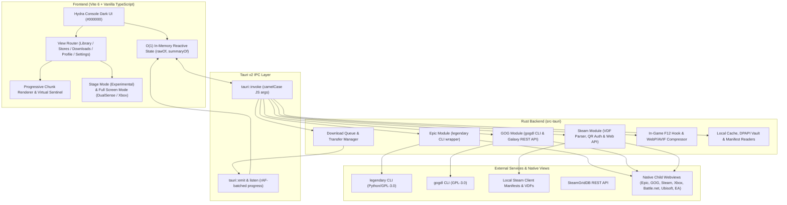
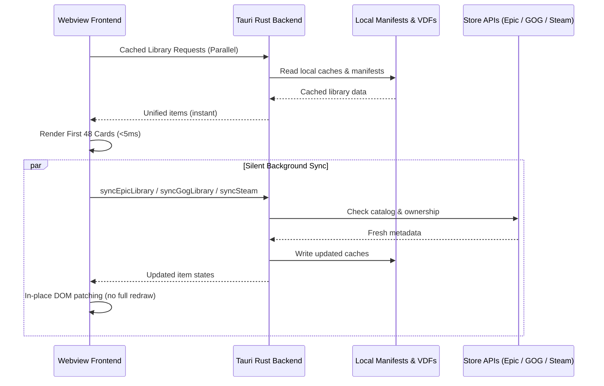

# Architecture & Technical Design — Efxlve Launcher

This document describes the high-level architecture, subsystem boundaries, data flow pipelines, and design decisions of **Efxlve Launcher** as a Universal Gaming Hub.

---

## 1. High-Level System Architecture

Efxlve Launcher is built on **Tauri v2**, combining a lightweight native **Rust** backend with a frameworkless **Vanilla TypeScript (Vite 6)** frontend.

---

## 2. Core Data Flow: "Cache-First, Async Network Sync" (Heroic Model)

To guarantee instantaneous startup (<100ms) with zero network blocking:
1. **Stage 1 (Immediate Disk Hydration):** On launch, `epic_cached_library`, `gog_cached_library`, and local Steam manifests are read directly from local disk caches (`%USERPROFILE%\.config\legendary\`, `gogdl\`, and Steam `appcache/` / `steamapps/`). The entire unified library renders immediately without waiting for any network response.
2. **Stage 2 (Silent Background Sync):** Asynchronous background tasks query `legendary list`, GOG Galaxy endpoints, and Steam ownership APIs, updating caches and applying deltas without interrupting the user.
3. **Stage 3 (Progressive Reactive Updates):** As achievements, playtime, and game updates resolve in the background, targeted DOM updates are applied to the active cards/buttons without full-page re-renders.

**Game page lookups follow the same rule.** Every store, score, news, spec and
compatibility answer is written to disk, including "nothing found"
(`src-tauri/src/lookup_cache.rs` owns the envelope). A missing entry is the only
one that waits for the network; an aged entry is served as it is and refreshed
behind the page. A stored miss is retried after a month, so a game that reaches
a store later is picked up without pinning the page to an old answer. The
library's rating sort and rating facet read the critic files already on disk
(`epic_cached_critic_scores`, `src/core/game-ratings.ts`) instead of opening a
page per game.

---

## 3. Key Subsystems & Design Invariants

### 3.1 Progressive Chunk Rendering (Virtual Sentinel)
- Managing 500+ games in a flat DOM would create **7,000+ DOM nodes**, consuming significant RAM and causing frame drops during filtering and sorting.
- Instead, the library employs **Progressive Chunking**:
  - The initial viewport renders **48 cards**.
  - A 24px invisible `#lib-scroll-sentinel` is placed at the grid bottom.
  - A native `IntersectionObserver` detects when the user scrolls near the end and seamlessly appends chunks of **36 cards** via `sentinel.insertAdjacentHTML("beforebegin", ...)`.
  - Search keystrokes are protected by a **120ms debounce**, guaranteeing snappy input feedback.

### 3.2 Stage Mode, Full Screen Mode & Gamepad Navigation
- Two controller surfaces share one gamepad poller: **Stage** (`src/features/stage/`) is the experimental controller-first shell, and **Full Screen Mode** (`src/features/gamepad/fullscreen-mode.ts`) is the classic desktop pages presented as a couch surface. Both stay available; Stage is labelled EXPERIMENTAL wherever it is offered.
- Full Screen Mode adds a couch shell on top of the desktop pages: `couch-shell.ts` owns the fixed top bar (pages, controller/battery, notifications, downloads, clock, exit), the Start menu, and the controller map. The desktop winbar and sidebar are hidden while the mode is on; every button keeps using the normal `data-view` / `data-act` router.
- `on-screen-keyboard.ts` is the text surface for a pad. Any text input selected with A opens a 49-key controller keyboard (digits, QWERTY, locale letters, symbols, shift, caret moves, space, backspace, Done). The real input keeps DOM focus, the keyboard writes through `setSelectionRange` + an `input` event, and `focusin`/scope rules close it when the field or dialog goes away.
- The focus engine remembers the last control per `View` and per dialog (`focusMemory`), so closing a confirm returns to the button that opened it and revisiting a page resumes where the player left it. The couch bar is its own focus region: Down enters the page, Up climbs back to the bar.
- LT/RT walk the five couch pages (`couch-pages.ts`), LB/RB switch the visible tab strip, Start opens the controller menu, Y/Select opens the palette, X favorites, Guide is a second menu key, and A/B can be swapped for a Nintendo-style controller. The hint bar hides while a menu, map or keyboard owns the pad and mirrors the active controller's glyphs.
- Controller vibration is a short `vibrationActuator` pulse on focus moves and presses; the same toggle is in Settings. The couch menu parks the native store child while it is open, so the sheet is never painted underneath a store front. Closing a sheet and leaving the store in the same click defers the child restore until `S.view` settles; otherwise an empty native storefront could cover the next page and swallow every click.
- Stage is a **mode, not a `View`**: `S.stage.active` switches the render branch, the desktop DOM stays alive underneath, and exit restores the page and scroll position. Its screens (Home, Library, Downloads, Settings, Programme) live in `S.stage.route`, so desktop navigation history never sees them.
- The Stage shell is a lazy chunk (`stage-boot.ts` imports `stage-render.ts` once); the desktop bundle keeps only the mode state, the boot frame and the gamepad bridge (`stage-bridge.ts`).
- The focus engine lives in `focus-engine.ts`: it owns the ring, the scoped candidate lists, the remembered control per `View`/dialog and the geometry search. Stage adds `[data-gp-item]` inside `#stage-root`; the renderer marks only the top overlay, and focus changes patch the Home hero/activity cards or the library side stage instead of rebuilding the route. The spatial engine scales its direction threshold with the focused control so a transformed card in the same row cannot capture an up/down move.
- Polling runs at requestAnimationFrame cadence with deadzone handling (axes: ±0.55) and falls back to a 40 ms idle timer for a connected but untouched pad.
- Supports Xbox, DualSense, Switch and generic DirectInput controllers through the standard Web Gamepad API; the glyphs follow the detected family, and haptics use `vibrationActuator` when the browser exposes it.

### 3.2.1 The Stage room: ambience, boot and attract mode

- `stage-ambience.ts` is an original generative theme, not a recording: a four-chord pad, a sparse pentatonic bell line and a generated impulse reverb. It is synthesised only while Stage is active, ducks under the launch curtain and closes with the mode. No sampled or third-party audio ships with the launcher; the licence-safe rule is "compose the feeling, never sample it".
- `stage-custom-audio.ts` lets a player replace that room with their own music: one global track and one per game, chosen in Settings and on the game's Extras tab. Settings can import a file on its own, then lists every imported file with preview, menu assignment and a two-step delete; deleting a file clears any game that pointed at it. The focused game's track wins; changes crossfade and a running game ducks the room. `stage_audio.rs` copies imports into `<app data>/stage-audio/` (64 MB, audio extensions only, non-empty) and the asset protocol serves them. Nothing is fetched from the network and no third-party track is bundled.
- `stage-intro.ts` paints one short boot mark with its own chime. It is dismissible with any input and skipped when reduced effects or the Console intro setting is off.
- `stage-idle.ts` owns attract mode. It is a class on `#stage-root`, not a re-render: after 75 quiet seconds on Home the chrome fades, the key art gets a slow pan and the clock/greeting stay legible. The first input wakes and is consumed, so waking never launches the item that happened to own the ring.
- `stage-console.css` holds the time-of-day light field, the film grain, the boot mark, the attract layout and the 1280 × 800 handheld pass. The light palette follows the local hour (`stage-tod-*`), so a TV at night is cool and a TV at sunset is warm. The light field is one static multi-gradient paint: no full-screen blur filter, no blend mode and no transform animation, because four animated 110 px blurs under a backdrop-filtered top bar were the one part of the room that could drop frames on a TV. The gradients are full-screen ellipses with a transparent tail; an earlier per-gradient `background-size` box clipped the colour at the box edge and left a visible vertical line through the art. The grain and the top-bar backdrop blur are dropped at 1600 px and above.
- The top bar is intentionally small: navigation on the left, status and the Quick menu on the right. Browser, music, Discord and power remain one press away in the Quick menu instead of competing with the shelf for header space.
- A handheld boots into Stage by default (`isSteamDeckDevice()` decides both `openAtLaunch` and `autoEnter` when no stored preference exists), and `handheld.css` enlarges the desktop shell's thumb targets without changing its layout. The Guide button opens Stage from desktop; inside Stage it opens the Quick menu.
- The TV/handheld safe area is a **content inset**, not a window inset: it moves the hero copy, hint bar and page padding while the art stays edge-to-edge. Shrinking `.stage-shell` instead left the root background visible as a black border around the picture.

### 3.3 Embedded Child Webviews (Multi-Storefront)
- 8 embedded store views: Epic Games, GOG.COM, Steam, Xbox (PC-filtered), Battle.net, Ubisoft, EA, and Amazon Games (Luna claims).
- Built via Tauri's native `WebviewBuilder::new(...)` using the `unstable` feature flag and `window.add_child`.
- OS resize synchronization is managed through the native Windows `tauri::WindowEvent::Resized` event hook to eliminate black borders during window snapping or maximizing.
- **Rule:** Never pass `additional_browser_args` to `WebviewBuilder`, as it silently breaks child webview rendering in WebView2.

### 3.4 Hardware-Accelerated Screenshot Hook
- In-game screenshot capture runs through a dedicated low-priority background thread in `src-tauri/src/legendary/screenshots.rs`.
- When no game is running, thread wakeups sleep for 250ms (reducing idle CPU consumption by 92%).
- Screenshots can be converted to compressed WebP/AVIF asynchronously off the UI thread.
- Native capture, clips and the Windows HUD are Windows-only. Linux/macOS use a stub that reports the feature as unsupported; the gallery still reads screenshots from disk and the overlay hides the capture tabs.

### 3.5 Save Backup Pipeline
- `legendary/backup.rs` owns local backups and restore snapshots: a raw save-folder copy plus `backup_info.json` under `<config>/backups/<safe-key>/<timestamp>/`.
- `cloud_backup/` adds the transport layer: `archive.rs` packs/unpacks `.tar.gz`, `folder.rs` writes into a user-synced directory, `webdav.rs` talks to Nextcloud-style servers, and `gdrive.rs` uses the hidden `appDataFolder` scope.
- Every restore snapshots the current saves first. If the snapshot fails, the restore is refused. Details and open work are in [CLOUD_SAVES.md](./CLOUD_SAVES.md).

### 3.6 Upscaler DLL Manager (Windows)
- `src-tauri/src/upscalers/` owns the per-game scan (`scan.rs`), the launcher cache (`store.rs`), the public catalog (`catalog.rs`), the verified download (`download.rs`) and the swap/restore (`swap.rs`).
- The scan matches only the nine known file names (`nvngx_dlss.dll`, `nvngx_dlssg.dll`, `nvngx_dlssd.dll`, the FSR 3.1 pair and the XeSS family), reads their PE file version and MD5, and shows them on the Manage panel's **Upscalers** tab. Backup folders such as another tool's `_DLSS_Backup` tree are skipped.
- A swap keeps the original beside the game file as `<name>.dlsss`, so **Restore original** never needs a network service.
- Catalog downloads come from the public DLSS Swapper manifest. The archive MD5, extracted DLL MD5 and Authenticode signature are verified before the file enters the launcher cache; no upscaler binary is bundled with the launcher.
- The feature is Windows-only and hidden on Linux/macOS. A target must be an existing known DLL inside the game folder the caller named.
