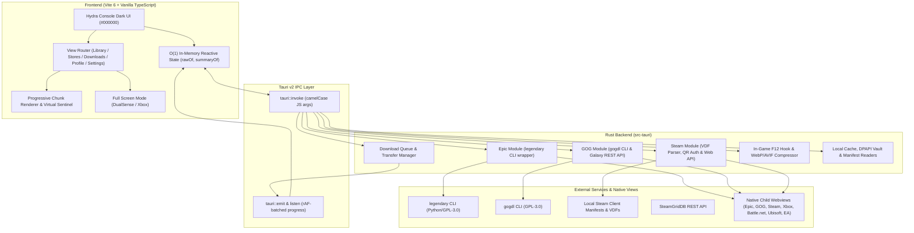
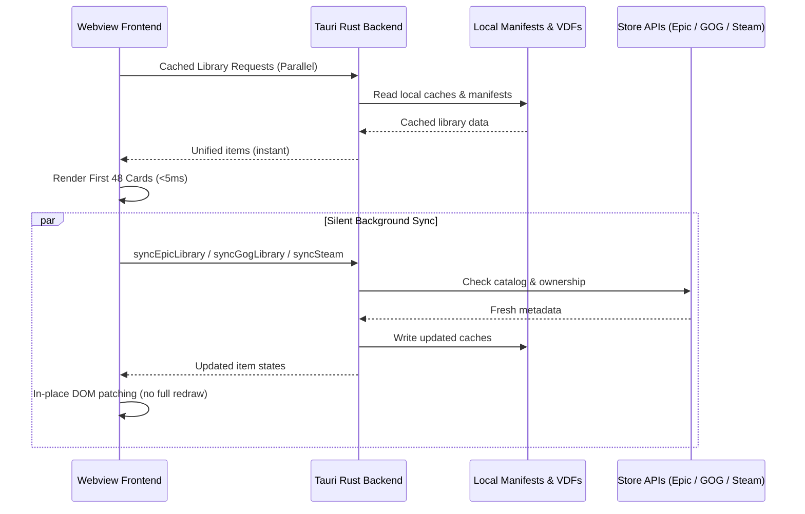

# Architecture & Technical Design — Efxlve Launcher

This document describes the high-level architecture, subsystem boundaries, data flow pipelines, and design decisions of **Efxlve Launcher** as a Universal Gaming Hub.

---

## 1. High-Level System Architecture

Efxlve Launcher is built on **Tauri v2**, combining a lightweight native **Rust** backend with a frameworkless **Vanilla TypeScript (Vite 6)** frontend.

---

## 2. Core Data Flow: "Cache-First, Async Network Sync" (Heroic Model)

To guarantee instantaneous startup (<100ms) with zero network blocking:
1. **Stage 1 (Immediate Disk Hydration):** On launch, `epic_cached_library`, `gog_cached_library`, and local Steam manifests are read directly from local disk caches (`%USERPROFILE%\.config\legendary\`, `gogdl\`, and Steam `appcache/` / `steamapps/`). The entire unified library renders immediately without waiting for any network response.
2. **Stage 2 (Silent Background Sync):** Asynchronous background tasks query `legendary list`, GOG Galaxy endpoints, and Steam ownership APIs, updating caches and applying deltas without interrupting the user.
3. **Stage 3 (Progressive Reactive Updates):** As achievements, playtime, and game updates resolve in the background, targeted DOM updates are applied to the active cards/buttons without full-page re-renders.

**Game page lookups follow the same rule.** Every store, score, news, spec and
compatibility answer is written to disk, including "nothing found"
(`src-tauri/src/lookup_cache.rs` owns the envelope). A missing entry is the only
one that waits for the network; an aged entry is served as it is and refreshed
behind the page. A stored miss is retried after a month, so a game that reaches
a store later is picked up without pinning the page to an old answer. The
library's rating sort and rating facet read the critic files already on disk
(`epic_cached_critic_scores`, `src/core/game-ratings.ts`) instead of opening a
page per game. The story-length sort works the same way from the HowLongToBeat
answers (`epic_cached_hltb_times`, `src/core/hltb-times.ts`), then fills the
games that have no stored answer in a quiet background pass
(`src/features/library/hltb-lengths.ts`).

---

## 3. Key Subsystems & Design Invariants

### 3.1 Progressive Chunk Rendering (Virtual Sentinel)
- Managing 500+ games in a flat DOM would create **7,000+ DOM nodes**, consuming significant RAM and causing frame drops during filtering and sorting.
- Instead, the library employs **Progressive Chunking**:
  - The initial viewport renders **48 cards**.
  - A 24px invisible `#lib-scroll-sentinel` is placed at the grid bottom.
  - A native `IntersectionObserver` detects when the user scrolls near the end and seamlessly appends chunks of **36 cards** via `sentinel.insertAdjacentHTML("beforebegin", ...)`.
  - Search keystrokes are protected by a **120ms debounce**, guaranteeing snappy input feedback.

### 3.2 Full Screen Mode & Gamepad Navigation
- **Full Screen Mode** (`src/features/gamepad/fullscreen-mode.ts`) presents the classic desktop pages as a couch surface.
- Full Screen Mode adds a couch shell on top of the desktop pages: `couch-shell.ts` owns the fixed top bar (pages, controller/battery, notifications, downloads, clock, exit), the Start menu, and the controller map. The desktop winbar and sidebar are hidden while the mode is on; every button keeps using the normal `data-view` / `data-act` router.
- `on-screen-keyboard.ts` is the text surface for a pad. Any text input selected with A opens a 49-key controller keyboard (digits, QWERTY, locale letters, symbols, shift, caret moves, space, backspace, Done). The real input keeps DOM focus, the keyboard writes through `setSelectionRange` + an `input` event, and `focusin`/scope rules close it when the field or dialog goes away.
- The focus engine remembers the last control per `View` and per dialog (`focusMemory`), so closing a confirm returns to the button that opened it and revisiting a page resumes where the player left it. The couch bar is its own focus region: Down enters the page, Up climbs back to the bar.
- LT/RT walk the five couch pages (`couch-pages.ts`), LB/RB switch the visible tab strip, Start opens the controller menu, Y/Select opens the palette, X favorites, Guide is a second menu key, and A/B can be swapped for a Nintendo-style controller. The hint bar hides while a menu, map or keyboard owns the pad and mirrors the active controller's glyphs.
- Controller vibration is a short `vibrationActuator` pulse on focus moves and presses; the same toggle is in Settings. The couch menu parks the native store child while it is open, so the sheet is never painted underneath a store front. Closing a sheet and leaving the store in the same click defers the child restore until `S.view` settles; otherwise an empty native storefront could cover the next page and swallow every click.
- The focus engine lives in `focus-engine.ts`: it owns the ring, the scoped candidate lists, the remembered control per `View`/dialog and the geometry search. The spatial engine scales its direction threshold with the focused control so a transformed card in the same row cannot capture an up/down move.
- Polling runs at requestAnimationFrame cadence with deadzone handling (axes: ±0.55) and falls back to a 40 ms idle timer for a connected but untouched pad.
- Supports Xbox, DualSense, Switch and generic DirectInput controllers through the standard Web Gamepad API; the glyphs follow the detected family, and haptics use `vibrationActuator` when the browser exposes it.

### 3.3 Embedded Child Webviews (Multi-Storefront)
- 8 embedded store views: Epic Games, GOG.COM, Steam, Xbox (PC-filtered), Battle.net, Ubisoft, EA, and Amazon Games (Luna claims).
- Built via Tauri's native `WebviewBuilder::new(...)` using the `unstable` feature flag and `window.add_child`.
- OS resize synchronization is managed through the native Windows `tauri::WindowEvent::Resized` event hook to eliminate black borders during window snapping or maximizing.
- **Rule:** Never pass `additional_browser_args` to `WebviewBuilder`, as it silently breaks child webview rendering in WebView2.

### 3.4 Hardware-Accelerated Screenshot Hook
- In-game screenshot capture runs through a dedicated low-priority background thread in `src-tauri/src/legendary/screenshots.rs`.
- When no game is running, thread wakeups sleep for 250ms (reducing idle CPU consumption by 92%).
- Screenshots can be converted to compressed WebP/AVIF asynchronously off the UI thread.
- Native capture, clips and the Windows HUD are Windows-only. Linux/macOS use a stub that reports the feature as unsupported; the gallery still reads screenshots from disk and the overlay hides the capture tabs.

### 3.5 Save Backup Pipeline
- `legendary/backup.rs` owns local backups and restore snapshots: a raw save-folder copy plus `backup_info.json` under `<config>/backups/<safe-key>/<timestamp>/`.
- `cloud_backup/` adds the transport layer: `archive.rs` packs/unpacks `.tar.gz`, `folder.rs` writes into a user-synced directory, `webdav.rs` talks to Nextcloud-style servers, and `gdrive.rs` uses the hidden `appDataFolder` scope.
- Every restore snapshots the current saves first. If the snapshot fails, the restore is refused. Details and open work are in [CLOUD_SAVES.md](./CLOUD_SAVES.md).

### 3.6 Upscaler DLL Manager (Windows)
- `src-tauri/src/upscalers/` owns the per-game scan (`scan.rs`), the launcher cache (`store.rs`), the public catalog (`catalog.rs`), the verified download (`download.rs`) and the swap/restore (`swap.rs`).
- The scan matches only the nine known file names (`nvngx_dlss.dll`, `nvngx_dlssg.dll`, `nvngx_dlssd.dll`, the FSR 3.1 pair and the XeSS family), reads their PE file version and MD5, and shows them on the Manage panel's **Upscalers** tab. Backup folders such as another tool's `_DLSS_Backup` tree are skipped.
- A swap keeps the original beside the game file as `<name>.dlsss`, so **Restore original** never needs a network service.
- Catalog downloads come from the public DLSS Swapper manifest. The archive MD5, extracted DLL MD5 and Authenticode signature are verified before the file enters the launcher cache; no upscaler binary is bundled with the launcher.
- The feature is Windows-only and hidden on Linux/macOS. A target must be an existing known DLL inside the game folder the caller named.

### 3.7 Media Archive (Disc / USB)
- `src-tauri/src/media_archive/` owns the archive format (`format.rs`), media presets (`profile.rs`), packing (`pack.rs`), restore (`restore.rs`), already-compressed bypass (`bypass.rs`), size estimation (`estimate.rs`), optional xtool precompression (`xtool.rs`), store registration (`store.rs`) and Windows optical writing (`disc.rs`). The frontend screen is `src/features/archive/`.
- One backup is a folder with `manifest.efxmeta.json` and `*.efxpak.NNN` volumes. Format version 2 adds stored blocks for already-compressed files and an optional xtool-wrapped stream; version 1 backups still restore. Format version 3 adds four `.efxpar.NNN` parity files per volume, with a SHA-256 for every shard and parity file, and places each volume's parity on the next disc/folder so a lost disc leaves its parity elsewhere; restore repairs up to four damaged shards per volume and can rebuild a missing volume when its data-shard count fits those four parity shards. The opt-in full-volume mode raises parity to the data-shard count, roughly doubling the archive, so any one whole disc can be rebuilt. `profile.rs` sizes a volume for CD-R, DVD-5/9, Blu-ray 25/50/100 or FAT32 (under 4 GiB). Optical profiles put one volume and a manifest copy in a self-contained `disc-N` folder, so each folder can be burned as one disc; USB profiles stay flat.
- The tar stream is compressed as independent zstd frames (64 MiB maximum). A damaged frame (or a stored block) fails its own SHA-256 check with the volume and block number; the rest of the backup is not poisoned.
- `estimate.rs` samples the largest files with zstd, or through xtool when one is configured, and reports the expected size and volume count before a backup. The parity reserve is `total / 12` normally and `total` in full-volume recovery mode, so the free-space check and plan roughly double there too. The estimate can be cancelled from the same panel at the next sample boundary. The free-space check uses that estimate once it exists; otherwise it uses the uncompressed size.
- The backup screen defaults to the last folder a backup finished in, then a connected removable drive (skipping the game's own drive), then a writable user folder; restore still defaults to the archive's original install parent. The target row lists other writable removable drives, the plan warns when the backup shares the game's drive, and `archive_plan` disables Start when the target cannot be written without elevation.
- xtool is optional and stays outside the installer. The launcher downloads the pinned 0.7.9 zip from GitHub, checks its SHA-256, unpacks it into its data folder and reports progress. A backup made with xtool needs the same tool to restore; the restore screen can install or point at it.
- Restore reads volumes from the manifest folder, automatically discovered sibling `disc-N` folders and any extra folders the user adds, verifies each block, unpacks into a staging folder and only then replaces the game folder. For v3 it first verifies the parity and data-shard hashes and rebuilds damaged shards into a temporary volume. The restore screen can verify every block, and a finished backup can verify itself immediately. Verification reads every block and checks its SHA-256 without writing anything or needing xtool. Steam, GOG and custom records are rewritten against the new path; Epic and Amazon go through their existing import commands. Store registration writes local records only: it never grants ownership or bypasses DRM, so Steam, Epic and Amazon games still need their client and an owning account.
- `disc.rs` drives Windows IMAPI2 through PowerShell: it lists recorders with the inserted media, blank/free-space state and write-once/rewritable/read-only flags; it requires a blank disc and builds the image with ISO 9660 + Joliet for CD or UDF for DVD/Blu-ray, then checks the exact image size against the free sectors and writes it. Rewritable media can be quick-erased or fully erased from the same panel. Linux uses `xorriso` (mkisofs then cdrecord) and macOS `drutil` for the same folder burn and quick/full erase flow; those paths are exercised by mocked-tool tests. Burning/erase and long archive jobs hold a keep-awake guard. Burning is marked experimental until it passes on real CD/DVD/BD media on each platform. `src/restore_main.rs` builds `efxlve-restore.exe`, a CLI that reuses the same restore engine for a machine without the launcher; it restores files or verifies every block (`--verify`) and leaves store registration to the client's install/verify step. Reed-Solomon parity and a clean-machine pass for the standalone restorer remain open work; see `TODO.md`.

### 3.8 Exophase Mirror
- `src-tauri/src/exophase.rs` owns the read-only profile mirror; `src/features/profile/exophase-view.ts` renders the Exophase tab and `exophase-actions.ts` owns the load/save state. The tab is separate from the launcher profile: local Steam/Epic data stays authoritative and the two totals are never merged.
- Exophase has no documented public API. The site page and its public `api.exophase.com/public/player/...` endpoints are read inside a hidden WebView2 child webview, because a plain HTTP client is challenged by Cloudflare. The fetch runs from the `www.exophase.com` origin, which the API allows; the child webview is closed after the read and no token or key is stored. The settings field accepts a username, a profile URL or the numeric player id.
- The answer is cached in `exophase/cache.json` through `lookup_cache` (schema 2, 6 hours). A stale copy is served when the site is temporarily blocked, and the tab shows both Exophase's own `lastsync` and when the launcher last read it. Exophase only refreshes when the user runs its profile sync, so the tab says so instead of implying live data. Game cards use the API's 288x158 `l` art and the hero uses the 2560x1440 `o` art; the 64x64 `t` tile is only a last resort.
- The feature is read-only and unaffiliated with Exophase; the tab carries the third-party note. It never writes to Exophase, and the site's own gamercards are not embedded.
