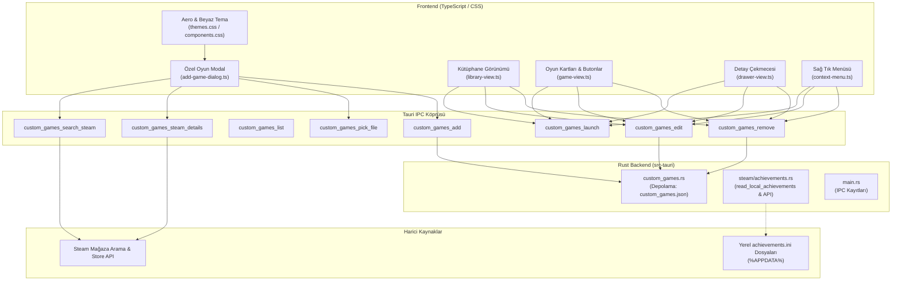

# Özel Oyun Ekleme ve Gelişmiş Başarım Sistemi Raporu

**Tarih:** 21 Ekim 2026  
**Proje:** Efxlve Launcher (`efxlve_launcher`)  
**Durum:** Çalışıyor; ilk raporun ardından gelen düzeltmeler aşağıda.

> **Son durum (inceleme sonrası):** İlk sürümdeki “Tamamlandı” notu çalışma zamanını
> kapsamıyordu. Özel oyun penceresindeki `onclick="event.stopPropagation()"`, içerideki
> tüm `data-act` tıklamalarını (Gözat, Kaydet, İptal, X) global yönlendiriciden
> koparıyordu; bu yüzden ekleme akışı ölüydü. Düzeltildi.
>
> Bu incelemede ayrıca tamamlananlar:
> - Emülatör başarımları artık Steam istemcisi/şeması olmadan, herkese açık
>   `steamcommunity.com/stats/<appid>/achievements` sayfasından tanımları çeker;
>   kilitler yerel `achievements.ini`/`achievements.json` dosyasından okunur.
> - Canlı izleyici, Steam kurulu olmasa da emülatör dosyasını izler; Steam ve özel
>   oyun yolları ayrıldı (`steam_start_custom_achievement_watcher`).
> - Özel oyun düzenleme penceresi, IGDB arama yedeği, kapak/hero yedeği, Steam
>   meta verisinden tür/geliştirici aktarımı, süre kaydı, launcher’dan durdurma,
>   silme onayı ve profil listesi eklendi.
> - Launcher dışından başlatılan özel oyunlar süreç izleyicisiyle yakalanıyor;
>   süre ve başarım izleme aynı yoldan başlıyor. Klasörden toplu oyun içe aktarma
>   da eklendi.
> - Ayarlar > Başarımlar bölümü bildirim açma/kapama, ses, oyun içi overlay
>   bildirimi ve canlı test imkânı veriyor.
> - Emülatör dosyası olmayan oyunda yalnızca tanımlar gösterilir; arayüz bunun
>   yerine güvenilir kaynak olmadığını söyler.

---

## 1. Yönetici Özeti ve Arka Plan (Executive Summary)

Bu çalışma, launcher'ın iki kritik alanını modern standartlara ulaştırmak amacıyla yürütülmüştür:
1. **Gelişmiş Özel Oyun Ekleme (Custom Games System):**  
   GOG Galaxy ve Hydra Launcher deneyimlerinde olduğu gibi; günümüzde dijital mağazalarda satışı bulunmayan (retro/abandonware oyunlar: örn. *NFS Underground 2*, *Minecraft: Story Mode* vb.) veya harici kaynaklardan temin edilen oyunların kütüphaneye kolayca eklenebilmesi. Tek tıkla Steam mağaza veritabanında arama yaparak kapak görseli, çıkış yılı, açıklama ve Steam App ID'sini otomatik getiren ve çalıştırılabilir (`.exe`) dosya olmadan da kütüphaneye eklenebilen esnek bir yapı kurulmuştur.

2. **Yerel ve Harici Başarım Entegrasyonu (Achievement System):**  
   Epic Games gibi bazı platformlarda veya harici oyun sürümlerinde başarım desteğinin eksik olması sebebiyle, oyunların Steam App ID'leri üzerinden başarım verilerini çekebilen ve gelecekte yerel emülatörlerin (`Goldberg`, `CODEX`, `RUNE` vb.) `%APPDATA%` altındaki `achievements.ini` dosyalarını okuyabilecek temel backend altyapısı inşa edilmiştir.

3. **Tematik Uyum ve Kusursuz UI Entegrasyonu:**  
   Eklenen yeni pencerelerin launcher'ın Windows 7 / Frutiger Aero (buzlu cam, derin mavi başlıklar, iç gölgeli arama kutuları) ve Beyaz/OLED temalarıyla yüzde yüz görsel uyum sağlaması gerçekleştirilmiştir.

---

## 2. Mimari ve Bileşen Haritası



---

## 3. Yapılan Tüm Geliştirmeler ve Kod Değişiklikleri

### 3.1. Rust Backend Altyapısı
- **`src-tauri/src/custom_games.rs`:**
  - `custom_games_search_steam`: Steam API (`storesearch`) üzerinden girilen metne göre oyun arar; oyun adı, AppID, kapsül görseli (`header.jpg`) ve kahraman arka planını anlık döndürür.
  - `custom_games_steam_details`: Seçilen oyunun kısa açıklaması, türleri ve çıkış yılını Steam `appdetails` API'sinden asenkron çeker.
  - `custom_games_add`: Yeni oyunu `AppData/custom_games.json` dosyasına benzersiz `custom::<slug>` kimliğiyle kaydeder.
  - `custom_games_edit`, `custom_games_remove`, `custom_games_launch`: Hem `custom::<slug>` hem de yalın ID formatlarını sorunsuz eşleştirecek esnek arama ve filtreleme eklendi.
  - `custom_games_launch`: Exe yolu boş olduğunda anlamlı bir hata mesajı döndürerek çökme durumlarını önler.
  - `custom_games_pick_file`: Windows yerel dosya seçici penceresiyle `.exe`, `.bat`, `.cmd`, `.lnk` dosyalarının kolayca seçilmesini sağlar.
- **`src-tauri/src/steam/achievements.rs`:**
  - `read_local_achievements`: Goldberg, CODEX, RUNE gibi yaygın Steam emülatörlerinin yerel INI dosyalarını okumak üzere hazırlanan fonksiyona `#[allow(dead_code)]` eklenerek derleme uyarısı sıfırlandı.
- **`src-tauri/src/main.rs`:**
  - Yeni komutların tamamı Tauri `.invoke_handler` zincirine bağlandı.

---

### 3.2. Frontend State ve Kütüphane Entegrasyonu
- **`src/custom-games.ts`:**
  - `CustomGame`, `SteamStoreSearchHit`, `SteamGameStoreDetails` arayüzleri oluşturuldu.
  - `customGameToSummary` ve `customGameToLibraryItem` dönüştürücülerinde `installed` durumu `Boolean(g.exePath && g.exePath.trim().length > 0)` olarak tanımlandı. Exe atanmamış oyunlar "yüklü değil / exe bekliyor" durumuna alındı.
- **`src/core/state.ts`:**
  - `ALL_STORES` listesine `"custom"` mağazası eklendi.
  - `loadEnabledStores()` fonksiyonunda `custom` mağazasının her zaman varsayılan olarak açık gelmesi sağlandı.
- **`src/features/library/library-view.ts`:**
  - `copiesOfStoreFiltered()` fonksiyonu güncellendi; `S.enabledStores.has("custom")` kontrolüyle `S.customSummaries` listesi kütüphanede filtrelenen ve listelenen oyunlar arasına dahil edildi.
- **`src/core/game-view.ts`:**
  - `achSummaryOf(appName)` fonksiyonu genişletildi: Oyun `custom::` ile başlıyorsa ve bir `steamAppId` tanımlıysa, Steam başarım önbelleğinden ilgili başarım özetini anında çeker (örn. kupa ikonu yanında `1/48` gösterimi).

---

### 3.3. Opsiyonel Exe Mimarisi ve Dinamik "Exe Seç" Butonu
Kullanıcının oyunu kütüphanesine sadece adıyla veya Steam aramasıyla ekleyebilmesi, çalıştırılabilir dosya zorunluluğunun olmaması sağlandı:
- **`src/features/custom-games/add-game-dialog.ts`:**
  - Exe alanındaki `required` ve kırmızı yıldız kaldırıldı.
  - Form kaydederken yapılan zorunlu exe kontrolü kaldırıldı.
  - `handlePickExeForGame(id: string)` fonksiyonu eklendi: Kart veya çekmeceden "Exe Seç" tıklandığında doğrudan dosya gezginini açar, seçilen yolu oyuna kaydeder, kütüphaneyi yeniler ve butonu "Oyna" durumuna geçirir.
- **`src/core/game-view.ts` (`epicActionButtons`):**
  - Exe tanımlı değilse: Klasör ikonlu `btn ghost` stilinde **"Exe Seç"** butonu gösterilir.
  - Exe tanımlı ise: Normal **"Oyna"** (`epic-play`) butonu gösterilir.
- **`src/features/drawer/drawer-view.ts`:**
  - Oyun detay çekmecesinin ana eylem alanında (`primaryAction` ve `actionsHtml`) exe yoksa büyük "Exe Seç" butonu gösterilir.
  - Çekmeceye ayrıca oyunu doğrudan silebilmek için "Kütüphaneden Sil" butonu eklendi.
- **`src/features/context-menu/context-menu.ts`:**
  - Sağ tık menüsünde exe atanmamışsa "Exe Seç" seçeneği, atanmışsa "Oyna" seçeneği sunulur.
  - Exe atanmış olsun veya olmasın, sağ tık menüsünden oyun her zaman silinebilir.

---

### 3.4. Görsel Tasarım ve Frutiger Aero Tema Entegrasyonu
- **`index.html` & `src/core/dom.ts`:**
  - Modal için bağımsız bir `<div id="custom-game-root"></div>` oluşturuldu ve `customGameRoot` olarak dışa aktarıldı. Bu sayede oyun detay çekmecesi veya diğer pencerelerle çakışması engellendi.
- **`src/styles/components.css`:**
  - `.custom-game-backdrop` ve `.custom-game-modal` varsayılan olarak CSS değişkenlerine (`var(--surface-1)`, `var(--line-strong)`) bağlandı.
  - Modal kapatma butonu launcher standardı olan `.modal-close-btn` ile değiştirildi.
- **`src/styles/themes.css`:**
  - **Aero Teması (`:root[data-surface="aero"]`):**
    - Modal paneline Windows 7 buzlu cam gradyanı (`linear-gradient(180deg, rgba(255, 255, 255, 0.97) 0, ...)`), üst parlama çizgisi ve dış cam kenarlığı uygulandı.
    - Arka plan karartmasına Aero yarı saydam mavi ton (`rgba(8, 45, 85, 0.35)`) ve blur uygulandı.
    - Başlık rengi Aero kurumsal mavisi (`var(--aero-heading)` - `#0c4a8c`) yapıldı.
    - Arama ve form kutularına Windows 7 gömme (sunken) efekt ve odaklanma parlaklığı verildi.
    - Arama açılır listesi (`custom-search-dropdown`) cam popover görünümüne ve mavi hover efektine (`var(--aero-gloss-hover)`) kavuşturuldu.
  - **Beyaz / OLED Teması (`:root[data-surface="white"]`):**
    - Net gölgeler (`box-shadow: 0 18px 48px rgba(15, 23, 42, 0.18)`) ve kontrastlı açık arka planlar entegre edildi.

---

### 3.5. Çok Dilli Yerelleştirme (16 Dil)
`src/locales/` altındaki 16 dil dosyasının tamamına (`en`, `tr`, `de`, `es`, `fr`, `it`, `ja`, `ko`, `pl`, `pt-BR`, `ru`, `th`, `zh-Hans`, `zh-Hant`, `ar`, `hi`) yeni anahtarlar eklendi:
- `customGames.setExe`: Exe Seç / Locate Executable
- `customGames.setExeHint`: Bu oyun için çalıştırılabilir (.exe) dosyasını seçin
- `customGames.exeSetSuccess`: Oyun çalıştırılabilir dosyası güncellendi

`npm.cmd run locales` kontrolü yapılarak 2792 anahtarın 16 dilde yüzde yüz eksiksiz eşleştiği doğrulandı.

---

## 4. Dosya Değişiklikleri Özeti

| Dosya | Değişiklik Özeti |
|---|---|
| `src-tauri/src/custom_games.rs` | Steam arama/detay API, CRUD, exe opsiyonelliği, esnek ID eşleştirme |
| `src-tauri/src/steam/achievements.rs` | `read_local_achievements` için `#[allow(dead_code)]` uyarısı giderildi |
| `src-tauri/src/main.rs` | Custom game IPC komutları tauri handler'a kaydedildi |
| `src/custom-games.ts` | Frontend model, IPC çağrıları ve `installed` kontrolü |
| `src/core/state.ts` | `"custom"` mağazası ve varsayılan mağaza desteği |
| `src/core/dom.ts` & `index.html` | `#custom-game-root` bağımsız modal katmanı |
| `src/core/game-view.ts` | Başarım sorgusu desteği & "Exe Seç" / "Oyna" buton ayrımı |
| `src/features/library/library-view.ts` | Kütüphane listesine özel oyunların dahil edilmesi |
| `src/features/drawer/drawer-view.ts` | Çekmece ana aksiyon butonu & özel oyun silme desteği |
| `src/features/context-menu/context-menu.ts` | Sağ tıkta "Exe Seç" ve her durumda silme imkanı |
| `src/features/custom-games/add-game-dialog.ts` | Arama, kapak önizleme, opsiyonel exe & `handlePickExeForGame` |
| `src/features/events/handlers/custom-games-handlers.ts` | `pick-custom-exe-for` ve güvenli silme tetikleyicileri |
| `src/styles/components.css` | Modal bileşen stilleri ve CSS değişken uyumu |
| `src/styles/themes.css` | Windows 7 Frutiger Aero ve White mod cam efektleri |
| `src/locales/*.json` (16 dosya) | Tüm dillerde yeni anahtarların eksiksiz tanımlanması |

---

## 5. Doğrulama ve Test Sonuçları

1. **Dil Doğrulaması:**
   ```bash
   npm.cmd run locales
   # Çıktı: 16 locale files, 2792 keys, all matched
   ```
2. **Frontend Derlemesi:**
   ```bash
   npm.cmd run build
   # Çıktı: tsc --noEmit && vite build -> Başarılı (0 hata)
   ```
3. **Rust Testleri:**
   ```bash
   cargo test --manifest-path src-tauri/Cargo.toml --no-default-features
   # Tüm testler geçti (canlı ağ testleri varsayılan olarak ignored).
   ```
4. **Git Commit Geçmişi:**
   - `b84c181d` — exe opsiyonel, Aero tema.
   - `1b3dc1f0` — public Steam Community şeması ve emülatör başarımları.
   - `04b190d1` — özel oyun düzenleme.
   - `78219842` — IGDB araması, kapak yedeği, durdurma, profil ve meta veri.
   - `9733fdff` — canlı izleyiciyi emülatör dosyasına ayırma.

---

## 6. Kalan İyileştirme Fırsatları

1. **Launcher dışından başlatılan özel oyunların canlı izlenmesi:** Şu anda süre/başarım izleme, oyun launcher üzerinden başlatıldığında kuruluyor. Dışarıdan başlatmalar için süreç taraması eklenebilir.
2. **Daha fazla emülatör kökü:** `%LOCALAPPDATA%`, `%PROGRAMDATA%` ve oyun klasörü altındaki ek `steam_settings` varyasyonları otomatik taranabilir.
3. **Toplu içe aktarma:** Bir klasördeki oyunları tek tek `.exe` seçmeden tarayıp kütüphaneye ekleme.
